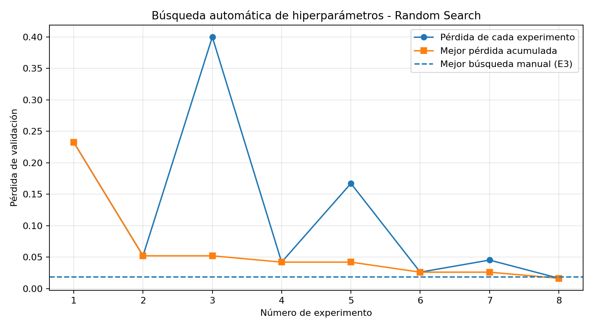

# 🍎 Clasificación de frutas y verduras mediante CNN

### Práctica 1 · Aprendizaje Automático II

**Grado en Ciencia e Ingeniería de Datos**  
Universidad de Las Palmas de Gran Canaria (ULPGC)  
Curso académico 2026–2027

---

## Descripción

En esta práctica desarrollamos un sistema de clasificación de imágenes utilizando **redes neuronales convolucionales (CNN)** implementadas en PyTorch.

El objetivo es reconocer diez categorías de frutas y verduras y estudiar cómo influyen los diferentes hiperparámetros en el rendimiento de los modelos.

Para ello, realizamos:

- Entrenamiento de una CNN configurable.
- Cinco experimentos con hiperparámetros elegidos manualmente.
- Selección del mejor modelo con validación.
- Evaluación final con un conjunto de prueba independiente.
- Búsqueda automática de hiperparámetros con **Random Search**.
- Transfer Learning con **ResNet18**.

## Dataset

Trabajamos con imágenes pertenecientes a diez categorías:

`Apple` · `Avocado` · `Banana` · `Blackberry` · `Cucumber` · `Orange` · `Pear` · `Pepper` · `Strawberry` · `Tomato`

Antes del entrenamiento, revisamos el dataset para detectar imágenes duplicadas mediante hashes SHA-256.

De los **8.229 archivos originales**, obtuvimos **7.999 imágenes únicas**.

### Distribución de los datos

| Conjunto | Imágenes | Porcentaje |
|:---|---:|---:|
| Entrenamiento | 5.599 | 70 % |
| Validación | 1.600 | 20 % |
| Test | 800 | 10 % |
| **Total** | **7.999** | **100 %** |

Las imágenes se redimensionaron a **96 × 96 píxeles** para la CNN y se normalizaron antes de introducirlas en el modelo.

También probamos técnicas de *Data Augmentation*, como volteos horizontales, rotaciones y modificaciones de color.

> **Nota:** El dataset completo no se incluye en el repositorio debido a su tamaño.

## Arquitectura CNN

mplementamos una CNN configurable para poder comparar diferentes arquitecturas sin modificar todo el código.

La red incluye:

- Capas convolucionales (Conv2d).
- Normalización por lotes (BatchNorm2d).
- Funciones de activación ReLU y Leaky ReLU.
- Capas de MaxPooling.
- Adaptive Average Pooling.
- Capas completamente conectadas.
- Dropout para reducir el sobreajuste.

Para el entrenamiento utilizamos:

| Componente | Configuración |
|:---|:---|
| Framework | PyTorch |
| Optimizador | Adam |
| Función de pérdida | CrossEntropyLoss |
| Métrica principal | Accuracy |
| Control de entrenamiento | Early Stopping |
| Selección del modelo | Menor pérdida de validación |

El uso de **Early Stopping** permite detener el entrenamiento cuando la pérdida de validación deja de mejorar y conservar los mejores pesos obtenidos.

## Experimentos manuales

Realizamos cinco experimentos modificando distintos hiperparámetros, como la profundidad de la red, el número de filtros, el learning rate, el dropout y el tamaño del batch.

### Resultados

| Experimento | Mejor época | Val Loss | Val Accuracy |
|:---|---:|---:|---:|
| E1_base | 13 | 0,031261 | 99,25 % |
| E2_lr | 29 | 0,029115 | 99,00 % |
| **E3_profundidad** | **13** | **0,018380** | **99,63 %** |
| E4_batch_dropout | 29 | 0,018486 | 99,56 % |
| E5_aumento | 24 | 0,028360 | 98,88 % |

El mejor experimento fue **E3_profundidad**, ya que obtuvo la menor pérdida de validación.

### Curvas de entrenamiento


Las curvas permiten observar la evolución de la pérdida y del accuracy durante el entrenamiento, tanto para entrenamiento como para validación.

## Evaluación del mejor modelo

Una vez seleccionado E3, lo evaluamos utilizando las **800 imágenes reservadas para test**.

| Métrica | Resultado |
|:---|---:|
| **Accuracy de test** | **98,75 %** |
| Macro F1-score | 98,81 % |
| Predicciones correctas | 790 |
| Predicciones incorrectas | 10 |

### Matriz de confusión


La mayoría de las categorías se clasificaron correctamente.

Los errores se concentraron principalmente en `Pepper`, que presentó algunas confusiones con `Pear`, `Tomato` y `Apple`.

En general, el modelo mostró un rendimiento elevado sobre imágenes que no había utilizado durante el entrenamiento ni para seleccionar los hiperparámetros.

## Búsqueda automática: Random Search

Como ampliación, implementamos **Random Search** para probar automáticamente ocho combinaciones de hiperparámetros.

Cada configuración se entrenó durante un máximo de 12 épocas y se comparó utilizando la pérdida de validación.

### Resultados

| Experimento | Val Loss | Val Accuracy |
|:---|---:|---:|
| **RS_08** | **0,016289** | **99,65 %** |
| RS_06 | 0,025989 | 99,31 % |
| RS_04 | 0,041922 | 99,34 % |
| RS_07 | 0,045202 | 98,75 % |
| RS_02 | 0,051985 | 98,81 % |
| RS_05 | 0,167055 | 95,50 % |
| RS_01 | 0,232462 | 93,69 % |
| RS_03 | 0,399861 | 90,25 % |

La mejor configuración fue **RS_08**, que consiguió una pérdida de validación ligeramente inferior a la del mejor experimento manual.

### Evolución de Random Search



La gráfica muestra cómo fue evolucionando la mejor pérdida de validación a medida que se probaron nuevas configuraciones.

## Transfer Learning con ResNet18

También utilizamos **ResNet18**, una red preentrenada en ImageNet.

Aprovechamos sus capas de extracción de características y sustituimos la última capa para adaptarla a nuestras diez categorías.

Para este experimento utilizamos imágenes de **224 × 224 píxeles** y una GPU NVIDIA T4.

### Resultados

| Métrica | Resultado |
|:---|---:|
| Mejor época | 15 |
| **Val Loss** | **0,004542** |
| **Val Accuracy** | **99,93 %** |
| Tiempo de entrenamiento | 15,16 minutos |

### Curvas de entrenamiento


ResNet18 consiguió los mejores resultados de validación de todos los modelos estudiados.

> **Importante:** Los resultados de ResNet18 y Random Search corresponden a validación. El accuracy de test del 98,75 % pertenece al modelo E3.

## Comparación final

| Modelo | Val Loss | Val Accuracy | Test Accuracy |
|:---|---:|---:|---:|
| E3_profundidad | 0,018380 | 99,63 % | **98,75 %** |
| RS_08 | 0,016289 | 99,65 % | No evaluado |
| **ResNet18** | **0,004542** | **99,93 %** | No evaluado |

ResNet18 obtuvo la menor pérdida de validación, mientras que Random Search permitió mejorar ligeramente los resultados de la búsqueda manual.

El modelo E3 fue el seleccionado para la evaluación final sobre test.

## Tecnologías utilizadas

- **Python** — Lenguaje de programación.
- **PyTorch** — Implementación y entrenamiento de las redes neuronales.
- **Torchvision** — Transformaciones de imágenes y ResNet18.
- **NumPy y Pandas** — Tratamiento de datos y resultados.
- **Matplotlib** — Visualización de gráficas.
- **Scikit-learn** — Métricas de evaluación.
- **Google Colab** — Entorno de ejecución.
- **Google Drive** — Almacenamiento de resultados y modelos.

## Cómo ejecutar el proyecto

El proyecto se desarrolló en Google Colab.

1. Abrir el notebook `.ipynb` en Google Colab.
2. Activar la GPU desde `Entorno de ejecución → Cambiar tipo de entorno de ejecución`.
3. Instalar las dependencias necesarias.
4. Descargar y preparar el dataset.
5. Configurar la ruta del proyecto en Google Drive.
6. Ejecutar las celdas en orden.

La ruta utilizada durante el desarrollo fue:

```python
PROJECT_DIR = '/content/drive/MyDrive/AA2_Practica1_Fruits'
```

Esta ruta debe modificarse según la ubicación de los archivos de cada usuario.

> Ejecutar todos los experimentos desde cero puede llevar tiempo, especialmente Random Search y ResNet18.

## Conclusiones

Esta práctica nos permitió comprender mejor el funcionamiento de las **redes neuronales convolucionales (CNN)** y comprobar cómo influyen los hiperparámetros en su rendimiento.

Los cinco experimentos manuales lograron resultados altos y seleccionamos E3 porque mostró la menor pérdida de validación. Al evaluarlo sobre prueba, alcanzó un **98,75 % de accuracy**.

**Random Search** encontró una configuración levemente mejor en validación, mientras que **ResNet18** obtuvo los mejores resultados de validación del proyecto.

También comprobamos la importancia de preparar bien los datos, eliminar duplicados y mantener separados los conjuntos de entrenamiento, validación y prueba.

---

**Universidad de Las Palmas de Gran Canaria**  
*Aprendizaje Automático II · Curso 2026–2027*
